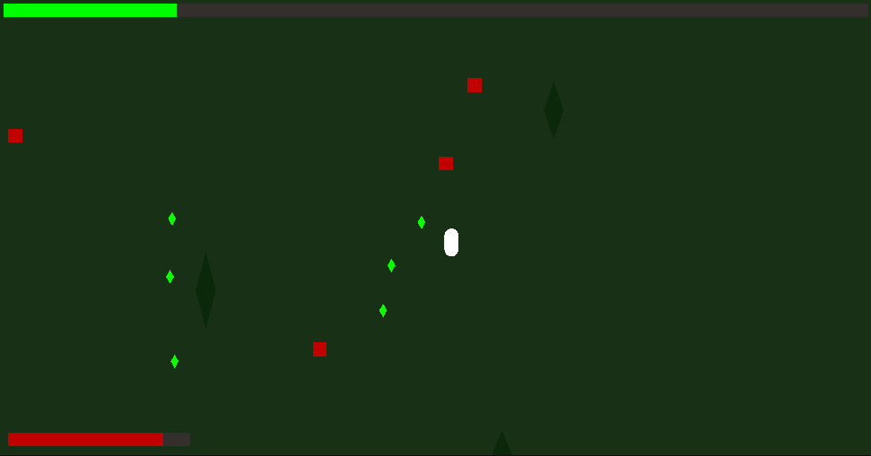

<div align="center">
  
</div>


# ExtinctionMarine - High-Performance 2D Horde Survival Roguelite 🦖

[]()
[]()
[]()
[]()

## Narrative
**Extinction Marine** is a dark sci-fi horde survival roguelite set on an uncharted, hostile exoplanet. Stranded after a catastrophic orbital drop, marine must defend himself against relentless waves of hyper-aggressive prehistoric apex predators. 

In an alien biosphere that defies all evolutionary logic, survival demands strict supply management, rapid reflexes, and escalating firepower - holding out just long enough to uncover the biological anomaly festering beneath the planet's surface.
</br></br>
> 🔒 The full source code for Extinction Marine is closed-source and currently in commercial development by ProperType. This repository serves as an architectural and visual showcase.


<div align="center">
  <p>
    <strong>Early Prototype (Initial Mechanics)</strong><br>
    
    <br>
    <em>Foundational architecture: Basic entity pooling and event-driven combat logic.</em>
  </p>
  <br>
  <p>
    <strong>Current State (v0.1.0 Alpha)</strong><br>
    
    <br>
    <em>Core gameplay loop: Scale-aware swarm AI (with bosses), zero-allocation patterns, interface-driven upgrade & ability system.</em>
  </p>
</div>

> ⚠️ **Notice:** GIFs above might not fully reflect the current state of the game - development moves fast, and new mechanics/assets are being deployed continuously.


## 🏗️ Technical Showcase & Architecture

This simulation was designed from the ground up using **Domain-Driven Design (DDD)** concepts to demonstrate how a game engine can be treated purely as an infrastructure/presentation layer.

### 1. Engine-Agnostic Core Logic (Clean Architecture)
The entire game state evaluation, experience tables, leveling math, and base entity configurations do not rely on Unity APIs. They are encapsulated inside a pure, decoupled C# Class Library (`GameLogic.dll`).
* **The Domain:** Entities like `PlayerEntity`, `RaptorEntity`, `MicroraptorEntity`, `StegosaurusEntity`,`TriceratopsEntity`, `TRexEntity`, and `DiplodocusEntity` inherit from a clean C# `Entity` abstraction.
* **Benefit:** The core mechanics are 100% unit-testable outside of Unity, completely immune to engine overhead, and could easily be ported to another framework or server architecture.

### 2. Zero-Allocation Swarm Mechanics (Advanced Object Pooling)
To sustain hundreds of active entities and projectiles simultaneously at 60+ FPS even on old hardware, the runtime completely bypasses the Garbage Collector (GC):
* **Optimized Queries:** Replaced all deprecated non-alloc APIs with the modern **Unity 6 compliant `Physics2D.OverlapCircle` utilizing static `ContactFilter2D.noFilter` buckets** to process neighborhood updates directly within pre-allocated `Collider2D[]` arrays.
* **Hybrid Disposal Patterns:** Regular swarm enemies (`EnemyPool`) and drop items (`GemPool`) utilize robust object recycle queues. High-tier Boss entities leverage dynamic `Instantiate` pipelines but share the exact same unified interface via explicit functional lambda callbacks (`Action<EnemyController> onDeath`).

### 3. Scale-Aware Swarm AI (Boids Separation)
Standard top-down physics engines suffer from "clumping" anomalies when pushing hundreds of steering agents toward a single target. This engine features a custom **Anti-Jitter Swarm Separation Algorithm**:
* **Edge-to-Edge Distance Calculation:** Instead of measuring center-to-center transforms (which collapses large hitboxes), the AI calculates distances utilizing the `Physics2D.Distance` schema.
* **Mass & Extents Awareness:** Small `MicroRaptors` organically yield to massive `Diplodocus` blockades via runtime bounding volume checks (`bounds.extents.sqrMagnitude`), dynamically amplifying separation forces with a smooth, linear velocity `Vector2.Lerp`.

### 4. Modular Interface-Driven Upgrade System
Weapon and marine stats scale dynamically through a highly decoupled interface ecosystem (`IUpgrade`).
* Modifiers like `DamageUpgrade`, `SpeedUpgrade`, `HealUpgrade`, `FireRateUpgrade`, `MaxHealthUpgrade`, `SplitShotUpgrade`, `RearGunUpgrade`, `BulletSpeedUpgrade`, `ConcussiveShellsUpgrade`, `MagnetUpgrade`, `MassUpgrade` and `PierceUpgrade` apply direct functional alterations to the `PlayerController`, while maintaining their own encapsulated state (`CurrentLevel`, `MaxLevel`).


### 5. Dynamic Event-Driven Data Pipelines
Tight coupling is eliminated by communicating exclusively through data-carrying decoupled event streams:
* Enemies evaluate damage thresholds inside the domain layer and broadcast events containing both positional coordinates and exact runtime domain data (`Action<Vector3, float> OnEnemyKilled`).
* The `GemPool` intercepts this broadcast, dynamically configuring empty pooled `ExpGem` structures with individual `XpReward` payloads on the fly, eliminating hardcoded value schemas.

### 6. Meta-Progression & Persistence (JSON Serialization)
Player unlocks, stats, and settings are decoupled from Unity's `PlayerPrefs` and handled via a custom generic JSON `SaveSystem`.
- **Event-Driven Unlocks (Abilities System):** When an enemy dies, it broadcasts its species (`OnEnemyKilled`). The `ProgressionSystem` listens and modifies the `ArmorySaveData` independent of the main game loop.

### 7. Weighted Wave Manager
Wave configurations are serialized using structs (`PoolSpawnWeight`) and arrays to eliminate unnecessary heap allocations during wave transitions. The system supports targeted "Boss Events" that spawn high-tier entities directly on top of the swarm queue.

### 8. Decoupled Audio Pipeline & Rate Limiting
Preventing audio clipping and protecting the audio thread from being overwhelmed during rapid interactions via a centralized infrastructure.
- **Unscaled-Time Throttling:** Custom rate-limiting logic ensures that repetitive sounds (like rapid UI hover events) do not flood the audio source. By utilizing `Time.unscaledTime`, the throttle remains fully functional and consistent even when the main game loop is paused (`Time.timeScale = 0f`) during Level-Up screens.

<details>
<summary><b>View Code Snippet: Audio Rate Limiting</b></summary>

```csharp
public void PlayUIHover()
{
    if (Time.unscaledTime - lastHoverTime >= hoverCooldown)
    {
        uiSource.PlayOneShot(hoverClip);
        lastHoverTime = Time.unscaledTime;
    }
}
```
</details>

## 💻 Technical Stack

* **Ecosphere:** .NET Standard 2.1
* **Game Engine:** Unity 6 LTS (Version 6000.3.17f1+ compliant).
* **Render Pipeline:** Universal Render Pipeline (URP 2D).
* **Input System:** Unity Input System Package (Fully event-driven action binding architecture).


## ⚖️ License

<div align="center">
<p>
  <p>
    
    Copyright (c) 2026&nbsp; <a href="https://github.com/mikolajj04">Mikołaj Jussak</a> | <a href="https://propertype.dev">ProperType</a>. All rights reserved.<br>
    See <a href="./LICENSE">LICENSE</a> for more information.
  </p>
</p>
</div>
